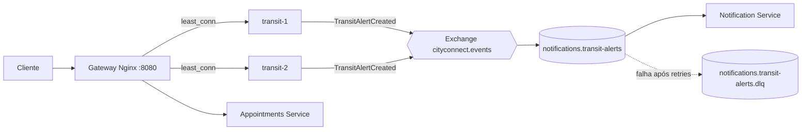

# CityConnect Services

Protótipo didático de uma plataforma urbana organizada em serviços independentes, escrito em **Java 21** com **Spring Boot**. O projeto ilustra nós independentes, comunicação REST e por eventos, isolamento de falhas e escala horizontal local.

> **Não é uma configuração pronta para produção.** As credenciais, o armazenamento em memória e o broker único existem só para facilitar o estudo. Veja [Limites do protótipo](#limites-do-protótipo-e-decisões-necessárias).

## Visão geral



| Componente | Função |
|---|---|
| **Gateway Nginx** (`:8080`) | Entrada HTTP única. Balanceia com `least_conn` entre duas instâncias do Transit Service e usa timeouts curtos. |
| **Transit Service** | Consulta demonstrativa de chegadas e publicação de alertas de trânsito. Publica `TransitAlertCreated` no exchange RabbitMQ `cityconnect.events`. |
| **Appointments Service** | API REST para criar e consultar agendamentos. Os dados ficam em memória. |
| **Notification Service** | Consome a fila durável `notifications.transit-alerts`, com retry e dead-letter queue. |
| **RabbitMQ** | Comunicação assíncrona. Painel local em `http://localhost:15672`. |
| **common** | Contrato versionado do evento e nomes de exchange e fila. Não contém lógica de negócio. |

## Tecnologias

- Java 21
- Spring Boot 3.5 (Web, Validation, AMQP, Actuator)
- Maven multi-módulo
- RabbitMQ 3.13
- Nginx 1.27
- Docker e Docker Compose

## Pré-requisitos

- **JDK 21**
- **Maven 3.9+** (ou o Maven integrado ao VS Code)
- **Docker** com Docker Compose (no Windows, Docker Desktop com WSL2)

```bash
java -version      # deve mostrar 21.x
mvn -v
docker compose version
```

O passo a passo de instalação e configuração no VS Code está em [VSCODE.md](VSCODE.md).

## Estrutura do projeto

```text
common/                          evento compartilhado e versionado
services/transit-service/        API REST e produtor AMQP
services/appointments-service/   API REST de agendamentos
services/notification-service/   consumidor AMQP
gateway/nginx.conf               roteamento e balanceamento local
docker/service.Dockerfile        Dockerfile multi-stage compartilhado pelos serviços
docker-compose.yml               topologia local multi-nó
api.http                         requisições prontas (extensão REST Client do VS Code)
.vscode/                         configurações de execução, tarefas e extensões
```

## Como executar

### Com Docker (recomendado)

Na pasta raiz do projeto:

```bash
docker compose up --build
```

A primeira execução demora alguns minutos, porque baixa as imagens e compila os serviços. Quando os health checks passam, as APIs respondem em `http://localhost:8080`.

Para parar:

```bash
docker compose down        # mantém os dados do RabbitMQ
docker compose down -v     # apaga também o volume do RabbitMQ
```

### Pelo VS Code, com depuração

1. Suba só o broker: `docker compose up -d rabbitmq`
2. Abra **Run and Debug** (`Ctrl+Shift+D`), escolha **Todos os serviços (local)** e pressione `F5`.

Neste modo, não há gateway nem balanceamento. As portas são:

| Serviço | Porta |
|---|---|
| Transit Service | `8081` |
| Appointments Service | `8082` |
| Notification Service | `8083` |

### Configuração por variáveis de ambiente

| Variável | Padrão | Uso |
|---|---|---|
| `SERVER_PORT` | `8081`, `8082` ou `8083` | Porta do serviço (nos contêineres, `8080`) |
| `RABBITMQ_HOST` | `localhost` | Endereço do broker |
| `RABBITMQ_PORT` | `5672` | Porta AMQP |
| `RABBITMQ_USER` | `cityconnect` | Usuário do broker (**somente desenvolvimento**) |
| `RABBITMQ_PASSWORD` | `cityconnect-dev` | Senha do broker (**somente desenvolvimento**) |
| `INSTANCE_NAME` | hostname | Nome da instância devolvido pelo Transit Service no header `X-Served-By` |

## API

| Método e caminho | Descrição | Respostas |
|---|---|---|
| `GET /api/transit/routes/{routeId}/arrivals` | Chegadas demonstrativas de uma linha | `200` |
| `POST /api/transit/alerts` | Publica um alerta de trânsito como evento | `202`, `400` |
| `POST /api/appointments` | Cria um agendamento | `201`, `400`, `409` |
| `GET /api/appointments/{id}` | Consulta um agendamento | `200`, `404` |
| `GET /actuator/health` | Estado de cada serviço (direto, sem gateway) | `200` |
| `GET /health` | Estado do gateway | `200` |

Regras de validação:

- Alerta: `routeId` e `message` obrigatórios; `message` com até 280 caracteres.
- Agendamento: `citizenId`, `officeId` e `startsAt` obrigatórios; **`startsAt` precisa ser uma data futura** (ISO-8601, UTC). Dois agendamentos no mesmo escritório e horário geram `409 Conflict`.

### Exemplos

Bash (Linux, macOS, WSL):

```bash
curl -i http://localhost:8080/api/transit/routes/23/arrivals

curl -i -X POST http://localhost:8080/api/transit/alerts \
  -H "Content-Type: application/json" \
  -d '{"routeId":"23","message":"Atraso na linha"}'

curl -i -X POST http://localhost:8080/api/appointments \
  -H "Content-Type: application/json" \
  -d '{"citizenId":"cid-42","officeId":"centro","startsAt":"2027-01-15T14:00:00Z"}'
```

PowerShell (Windows): use `curl.exe`, porque `curl` é um alias de `Invoke-WebRequest`.

```powershell
curl.exe -i http://localhost:8080/api/transit/routes/23/arrivals

curl.exe -i -X POST http://localhost:8080/api/transit/alerts -H "Content-Type: application/json" -d "{\"routeId\":\"23\",\"message\":\"Atraso na linha\"}"

curl.exe -i -X POST http://localhost:8080/api/appointments -H "Content-Type: application/json" -d "{\"citizenId\":\"cid-42\",\"officeId\":\"centro\",\"startsAt\":\"2027-01-15T14:00:00Z\"}"
```

Se preferir uma interface, o arquivo [`api.http`](api.http) tem as mesmas requisições para a extensão **REST Client** do VS Code.

## Verificando o comportamento distribuído

1. **Balanceamento.** Chame `/api/transit/routes/23/arrivals` várias vezes e observe o header `X-Served-By` alternar entre `transit-1` e `transit-2`.
2. **Evento assíncrono.** Publique um alerta e veja a notificação no log: `docker compose logs -f notification`.
3. **Fila durável.** Rode `docker compose stop notification`, publique alguns alertas e confira as mensagens acumuladas no painel do RabbitMQ. Com `docker compose start notification`, elas são consumidas.
4. **Falha de uma réplica.** Rode `docker compose stop transit-1` e continue chamando as chegadas: o gateway responde pela outra instância.
5. **Concorrência.** Repita o mesmo `POST /api/appointments` e confirme o `409 Conflict`.

## Tratamento de falhas nas notificações

O Notification Service separa o recebimento do evento da entrega da notificação:

- `TransitAlertListener` recebe o evento e verifica duplicidade por `eventId`.
- `NotificationChannel` é a interface de entrega. A implementação atual (`LogNotificationChannel`) escreve no log; um canal de e-mail, SMS ou push implementa a mesma interface.
- O `eventId` só é marcado como processado **depois** que a entrega tem sucesso. Se o canal lançar exceção, o evento não é marcado e pode ser reprocessado.

Quando a entrega falha, o Spring AMQP faz até **4 tentativas**, com espera crescente de 1 s a 10 s. Esgotadas as tentativas, a mensagem não volta para a fila: ela segue para a dead-letter exchange `cityconnect.events.dlx` e fica guardada na fila `notifications.transit-alerts.dlq`, onde pode ser analisada. Mensagens com conteúdo inválido vão direto para a DLQ.

Para testar, lance temporariamente uma exceção em `LogNotificationChannel.send`, publique um alerta e confira a mensagem em `notifications.transit-alerts.dlq`, na aba **Queues** do painel do RabbitMQ.

> Se a fila `notifications.transit-alerts` foi criada por uma versão anterior, apague-a (painel do RabbitMQ) ou rode `docker compose down -v`. O RabbitMQ não permite alterar os argumentos de uma fila existente e recusa a mudança com `PRECONDITION_FAILED`.

## Testes

```bash
mvn -B package
```

O build roda os testes unitários do Appointments Service (criação, consulta e rejeição de horário duplicado) e gera um `.jar` em `services/*/target/`.

## Fundamentos demonstrados

| Fundamento | Onde aparece | Próximo passo para produção |
|---|---|---|
| Nós independentes | Contêineres por serviço; duas instâncias de transporte | Orquestrador com distribuição por zonas e autoscaling |
| REST | APIs de transporte e agendamento | Contratos OpenAPI, autenticação e limites por cliente |
| Event-driven | Evento de alerta publicado e consumido via AMQP | Outbox transacional, deduplicação durável e monitoramento da DLQ |
| Transparência de localização | Gateway encaminha para o upstream sem expor réplicas ao cliente | DNS/service discovery e balanceador redundante |
| Tolerância a falhas | Timeouts do proxy, health endpoints, fila persistente, retry e dead-letter queue | Circuit breaker, bulkheads, broker em cluster e testes de caos |
| Replicação/escala | Réplicas do Transit Service atrás do Gateway | Réplicas sem estado e armazenamento externo compartilhado |
| Consistência | Contrato de evento com versão e ID | Política por domínio; consistência forte para reserva de vagas |

## Limites do protótipo e decisões necessárias

- Agendamentos são guardados em memória: reiniciar ou escalar o serviço perde dados e cada réplica teria uma visão diferente. Substituir por banco durável com restrição de unicidade e controle concorrente.
- A publicação RabbitMQ usa o fluxo simples de demonstração. Em produção, usar outbox transacional, publisher confirms e política de retry também no produtor.
- A deduplicação por `eventId` no consumidor é em memória e se perde ao reiniciar. Em produção, usar armazenamento durável com expiração, e monitorar o tamanho da DLQ com um procedimento de reprocessamento.
- A fila é durável, mas isso não substitui redundância do broker. Implantar cluster gerenciado ou RabbitMQ replicado, com backups e recuperação testada.
- O Nginx desta amostra é um único Gateway; em produção, replicá-lo e colocá-lo atrás de balanceador redundante.
- Integrações externas ainda são simuladas. Implementar adaptadores por provedor, timeouts, circuit breaker, cache com validade explícita e fallback com indicação de dado desatualizado.
- Adicionar segurança (OIDC/OAuth2, TLS, gestão de segredos), auditoria, métricas, tracing e SLOs antes de expor a plataforma.
- RPC/gRPC pode ser adotado para chamadas internas de baixa latência e contratos tipados; não é requisito para o primeiro corte. REST é mantido na borda e eventos são usados onde o acoplamento temporal deve ser reduzido.

## Solução de problemas

| Sintoma | Causa provável e solução |
|---|---|
| `release version 21 not supported` | O Maven ou o VS Code usa um JDK mais antigo. Aponte para o JDK 21 e ajuste o `JAVA_HOME`. |
| `Connection refused` em `localhost:5672` | O RabbitMQ não está de pé. Rode `docker compose up -d rabbitmq`. |
| `PRECONDITION_FAILED` no Notification Service | A fila antiga existe com outros argumentos. Apague-a ou rode `docker compose down -v`. |
| Porta `8080` ou `15672` em uso | Pare o processo que usa a porta ou mude o mapeamento no `docker-compose.yml`. |
| `POST /api/appointments` retorna `400` | Verifique se `startsAt` é uma data futura em ISO-8601 (UTC). |
| Publicação de alertas trava ou demora | Verifique alarmes de memória do RabbitMQ: `docker compose exec rabbitmq rabbitmq-diagnostics alarms`. |

Mais detalhes sobre ambiente, extensões e depuração em [VSCODE.md](VSCODE.md).
